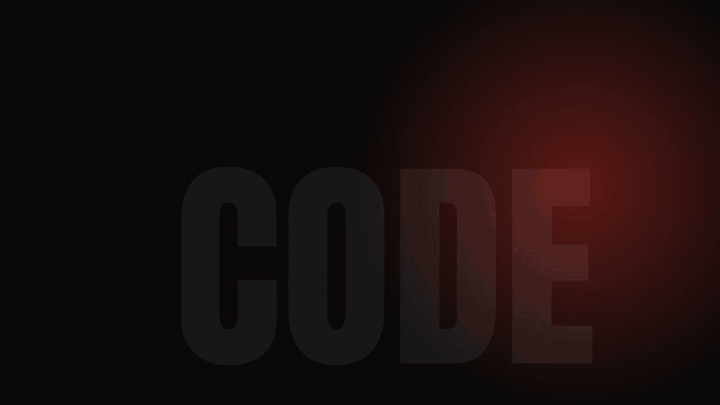

<p align="center">
  <a href="README.md">English</a> · <a href="README.de.md">Deutsch</a> · <a href="README.es.md">Español</a> · <b>Français</b> · <a href="README.pt-BR.md">Português</a> · <a href="README.zh-CN.md">简体中文</a>
</p>

[](docs/assets/open-motion-hero.jpg)

# Open Motion

**Le studio de motion design open source et auto-hébergé où chaque élément est un calque modifiable en direct.**

[](LICENSE) [](#-statut) [](#-architecture) [](docs/deploy-coolify.md) [](#-statut)

*Décrivez votre vidéo, parlez à votre facecam ou déposez des fichiers. L'IA construit les calques, vous les peaufinez en direct, et vous obtenez un MP4.*



[Démarrage rapide](#-démarrage-rapide) · [Fonctionnalités](#-fonctionnalités) · [Captures](#-captures-décran) · [Architecture](#-architecture) · [Déployer avec Coolify](docs/deploy-coolify.md) · [Guide](docs/guide.md) · [Licence](#-licence)

---

## Pourquoi Open Motion

Les générateurs vidéo IA vous livrent des pixels finis. Un mot faux dans le titre ou un graphique cinq centimètres trop à gauche, et il faut tout régénérer en croisant les doigts. Les logiciels de montage classiques offrent un contrôle total, mais chaque animation coûte des heures.

Open Motion choisit une troisième voie : **le motion design sous forme de code.** Chaque élément est un calque avec un cadre, un contenu et une temporalité. L'IA écrit ces calques, et vous les manipulez directement dans l'éditeur : glisser, redimensionner, taper. Le rendu se fait à la toute fin avec Chrome sans interface et FFmpeg, image par image, exactement comme dans l'aperçu.

En prime, tout ce qu'il faut pour une vidéo explicative : enregistrement facecam dans le navigateur, transcription avec horodatage par mot, graphiques ancrés aux mots prononcés, et montage directement dans le texte. Supprimez un lapsus, et la facecam, le son et les graphiques se recalent automatiquement.

## 🏆 Comparaison

|  | Générateurs vidéo IA | Logiciels de montage classiques | Open Motion |
| --- | --- | --- | --- |
| **Modifier un seul élément** | ❌ souvent tout régénérer | ✅ à la main | ✅ clic, saisie ou commentaire IA ; seul cet élément change |
| **Changer le contenu, garder le cadre** | ❌ | ⚠️ fastidieux | ✅ graphique → image IA → vidéo ; position et animation restent |
| **Facecam + transcription + montage par texte** | ❌ | ⚠️ souvent un logiciel en plus | ✅ intégré ; les graphiques suivent les mots lors des coupes |
| **Choisir son modèle d'IA** | ❌ celui du fournisseur | ❌ | ✅ vos propres clés : Claude, OpenAI, OpenRouter ; images via Kie.ai, OpenAI, OpenRouter, Gemini |
| **Auto-hébergé, vos données restent chez vous** | ❌ cloud | ✅ local | ✅ Docker + Coolify, un dossier par projet |
| **Code source** | ❌ | ❌ le plus souvent | ✅ AGPL-3.0 |

Soyons honnêtes : décrire des animations en code et les rendre dans un navigateur n'est pas nouveau. Notre apport, c'est tout ce qui manque quand on se contente du rendu : un modèle de calques que l'IA **et** l'humain modifient en même temps, un éditeur en direct sans rechargement, un flux facecam avec montage par texte, et un rendu qui s'adapte seul au matériel.

## ✨ Fonctionnalités

- **Système de calques :** texte, formes, graphiques dessinés (SVG), images, vidéo, audio. Chaque calque a un cadre, des keyframes, un easing et des transitions d'entrée et de sortie.
- **Éditeur en direct :** cliquer, glisser, redimensionner, taper directement dans l'aperçu. Une modification à la tête de lecture crée automatiquement une keyframe. Seuls les calques modifiés sont mis à jour.
- **Bande de scènes et réglages :** nom, durée et vitesse par scène, et tous les textes de la scène d'un coup d'œil.
- **Chat IA :** « Fais une animation de 20 secondes pour mon café » → scènes, textes, graphiques, images. Chaque réponse s'annule séparément.
- **Commentaires sur les éléments :** cliquez sur un élément, écrivez « @IA mets-le en vert », c'est fait.
- **Facecam :** enregistrement dans le navigateur ou import, son sur sa propre piste, mises en page (grand, coin, cercle, partagé) avec transitions douces.
- **Transcription avec horodatage par mot :** en local avec faster-whisper ou via OpenAI, ElevenLabs, Groq, Deepgram.
- **Ancres :** les graphiques s'accrochent aux mots prononcés.
- **Montage par texte :** supprimer des mots coupe la vidéo. Mots de remplissage et longues pauses sont suggérés ; le son reçoit des micro-fondus sans clic à l'export.
- **Images IA :** Kie.ai, OpenAI, OpenRouter ou Gemini, enregistrées localement aussitôt.
- **Export :** MP4 ou GIF, 720p ou 1080p, 15/30/60 i/s, texte plus net en option.
- **Rendu auto-ajusté :** détecte CPU, RAM et GPU (limites de conteneur comprises), planifie les workers et apprend de chaque export.
- **Interface bilingue :** anglais et allemand.
- **Auto-hébergé :** image Docker en variantes `slim` et `whisper`, éditeur et worker de rendu séparés.

## 📸 Captures d'écran

| Éditeur en direct | Chat IA |
| --- | --- |
| [](docs/assets/editor.png) | [](docs/assets/ai-chat.png) |
| **Transcription et ancres** | **Montage par texte** |
| [](docs/assets/transcript-anchors.png) | [](docs/assets/text-cut.png) |

<sub>La capture du chat IA montre une conversation mise en scène ; les modifications citées ont réellement été appliquées au projet.</sub>

**Vidéo d'exemple**, rendue entièrement à partir d'une Motion-Spec :


## 🚀 Démarrage rapide

**Avec Docker (recommandé) :**

```bash
git clone https://github.com/oliverhees/open-motion.git
cd open-motion
cp .env.example .env            # définir OPENMOTION_PASSWORD
docker compose -f docker-compose.yml -f docker-compose.local.yml --env-file .env up --build
# → http://localhost:4317
```

**Sans Docker (Node 22.18+, FFmpeg) :**

```bash
npm install
npx hyperframes browser ensure  # Chrome pour le rendu (une fois)
npm run example:assets          # fichiers d'exemple (Python + Pillow)
npm run editor:build
npm start                       # → http://localhost:4317
```

Ensuite : ⚙ Réglages → ajoutez vos clés API → 🩺 **Tester**.

**Sur votre serveur :** [guide Coolify pas à pas](docs/deploy-coolify.md)

## 🧩 Architecture

**Le cœur** est la **Motion-Spec**, un fichier JSON de scènes et de calques. L'éditeur, l'IA et le moteur de rendu ne lisent et n'écrivent que ce fichier. Les modifications passent uniquement par des **patchs** comme `set`, `setAt` (keyframe automatique), `swap` (changer le contenu, garder le cadre) ou `cut` (montage par texte). Chaque patch est validé et les erreurs reviennent en langage clair, pour que l'IA puisse se corriger.

**Stack :** [HyperFrames](https://github.com/heygen-com/hyperframes) (Apache 2.0) transforme du HTML en vidéo. L'animation utilise la **Web Animations API** du navigateur, volontairement sans GSAP dont la licence interdit l'usage dans les éditeurs d'animation visuels. TypeScript tourne directement sous Node 22 ; l'éditeur est en React + Vite. Éditeur et worker de rendu communiquent via une file d'attente sur fichiers.

Plus : [Guide](docs/guide.md) · [Référence Motion-Spec](docs/motion-spec.md)

## 🛡️ Sécurité

Connexion par mot de passe avec cookie `HttpOnly`/`SameSite=Lax` (`Secure` derrière HTTPS) et blocage après 10 échecs ; jetons d'API stockés uniquement sous forme de hash ; clés des fournisseurs jamais envoyées au navigateur ; protection CSRF ; SVG générés par l'IA assainis ; conteneur sans root. Vulnérabilité ? Voir [SECURITY.md](SECURITY.md).

## 🔧 Statut

**Bêta 0.1, couverte par 71 tests automatisés et des tests de bout en bout.** Prêt : cœur des calques, éditeur en direct, facecam, transcription locale, montage par texte, agent IA (mode test et fournisseurs simulés), connexion et jetons, éditeur et worker séparés, rendu auto-ajusté. À venir : test en direct de toutes les API avec de vraies clés, build Docker validé sur Coolify, connecteur MCP et Skill.

**Limites connues :** les API IA, image et transcription suivent la documentation et les formats de réponse des fournisseurs ; le test réel avec de vraies clés est en cours. Les scènes entières ne suivent pas encore les coupes par texte. Un seul mot de passe pour tous. Certains messages serveur sont encore en allemand.

Détails : [STATUS.md](STATUS.md)

## 🗺️ Feuille de route

1. **Connecteur MCP** pour Claude (web, Code, Cowork), Hermes et autres agents.
2. **Skill** avec règles de design, aide-mémoire de la spec et exemples.
3. **Scènes ancrées aux mots.**
4. **Timeline pro :** pistes, courbes de keyframes, pistes audio.

## 📜 Licence

Le cœur est publié sous **[GNU Affero General Public License v3.0 (AGPL-3.0)](LICENSE)**, licence open source approuvée par l'OSI. Copyleft : si vous modifiez Open Motion et le proposez comme service en réseau, vous devez publier votre code modifié. **Sans GSAP.**

## 🏠 Pas envie d'auto-héberger ?

Open Motion tourne entièrement sur votre propre infrastructure ([guide Coolify](docs/deploy-coolify.md)). Si vous préférez, **nous pouvons exploiter une instance dédiée pour vous.** Contact : [aiianer.de](https://aiianer.de) ou [Issues](https://github.com/oliverhees/open-motion/issues).

## 🤝 Contribuer

Issues, pull requests et discussions bienvenues. Voir [CONTRIBUTING.md](CONTRIBUTING.md) et le [Code de conduite](CODE_OF_CONDUCT.md).

---

<p align="center">Fait avec ❤️ et passion par <b>Oliver Hees – Der Aiianer</b> · <a href="https://aiianer.de">aiianer.de</a> · <a href="LICENSE">AGPL-3.0</a></p>
