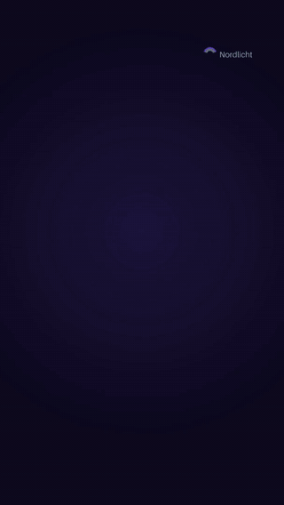
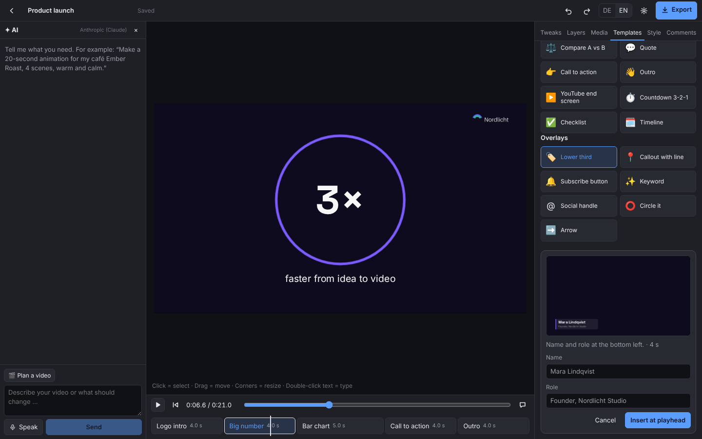
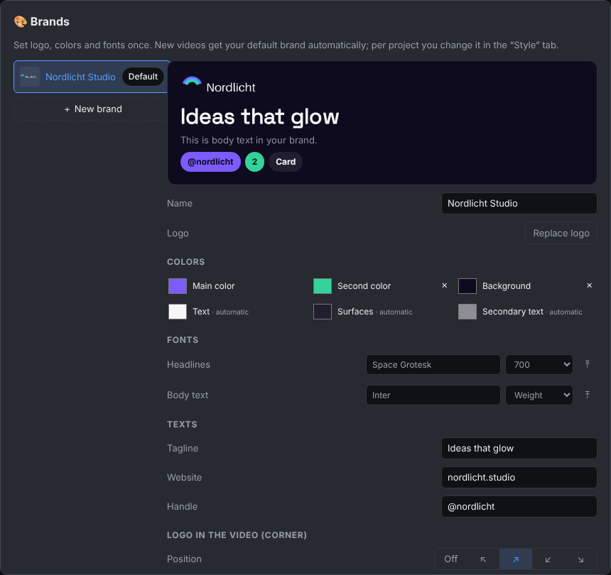

<p align="center">
  <b>English</b> · <a href="README.de.md">Deutsch</a> · <a href="README.es.md">Español</a> · <a href="README.fr.md">Français</a> · <a href="README.pt-BR.md">Português</a> · <a href="README.zh-CN.md">简体中文</a>
</p>

[](docs/assets/open-motion-hero.jpg)

# Open Motion

**The open-source, self-hosted motion graphics studio where every element is a live-editable layer.**

[](LICENSE) [](#-status) [](#-architecture) [](docs/deploy-coolify.md) [](#-status)

*Describe your video, talk into your facecam or drop in files. The AI builds layers, you fine-tune them live, and out comes an MP4.*


<sub>☝️ Built by Claude Code through the MCP in one go (brief → style "kinetic" → beat sheet → build → it looked at its own frames and fixed them → export). Not touched by hand. [MP4](docs/assets/showcase.mp4)</sub>

<p align="center"></p>

<sub>☝️ A 9:16 reel Claude Code built through the MCP from 5 templates in the brand "Nordlicht Studio" (a demo brand), then exported as MP4 and as transparent WebM. Not touched by hand.</sub>

[Quickstart](#-quickstart) · [Features](#-features) · [Screenshots](#-screenshots) · [Architecture](#-architecture) · [Deploy with Coolify](docs/deploy-coolify.md) · [Guide](docs/guide.md) · [License](#-license)

---

## Why Open Motion

AI video generators hand you finished pixels. If one word in the title is wrong or a graphic sits two inches too far left, you regenerate everything and hope. Classic editors give you full control, but every animation costs hours.

Open Motion takes a third path: **motion graphics as code.** Every element is its own layer with a frame, content and timing. The AI writes those layers, and you grab them directly in the editor: drag, resize, type. Rendering happens at the very end with headless Chrome and FFmpeg, frame by frame, exactly as you saw it in the preview.

On top of that you get what an explainer video needs: facecam recording in the browser, a transcript with per-word timing, graphics anchored to spoken words, and cutting right in the text. Delete a slip of the tongue, and facecam, audio and graphics shift along automatically.

## 🏆 How it compares

|  | AI video generators | Classic video editors | Open Motion |
| --- | --- | --- | --- |
| **Change a single element** | ❌ usually regenerate everything | ✅ by hand | ✅ click, type or leave an AI comment; only that element changes |
| **Swap content, keep the frame** | ❌ | ⚠️ tedious | ✅ graphic → AI image → video; position and animation stay |
| **Facecam + transcript + text-based cutting** | ❌ | ⚠️ often extra software | ✅ built in; graphics hang on words and move when you cut |
| **AI looks at its own result** | ❌ | ❌ | ✅ renders frames, scores them, fixes what is off (up to 2 rounds) |
| **Templates in your brand** | ⚠️ fixed looks | ⚠️ buy packs | ✅ 25 layout-tested scenes and overlays that follow your format, style, logo, colors and fonts |
| **Overlays for other editors** | ❌ | ✅ | ✅ WebM/MOV with transparent background, Lottie (beta) |
| **Choose your AI model** | ❌ vendor's model | ❌ | ✅ your Claude Code / Codex / OpenCode login or your own keys: Claude, OpenAI, OpenRouter; images via Kie.ai, OpenAI, OpenRouter, Gemini |
| **Self-hosted, your data stays with you** | ❌ cloud | ✅ local | ✅ Docker + Coolify, one folder per project |
| **Source code** | ❌ | ❌ mostly | ✅ AGPL-3.0 |

**And "Claude Motion" or prompt-to-video skills?** Claude Motion (Anthropic, beta for Team/Enterprise) and the popular Remotion/HyperFrames skills turn a prompt into animation code and a video. That works, and the best prompt guides all say the same: name timed beats, exact colors and fonts, safe areas, and look at frames before the final render. Open Motion has these rules **built into its master prompt** and its 14 styles, so you don't have to write a 40-line prompt. The difference starts after the first render: here every element stays an editable layer, your facecam and transcript are part of the project, you can cut in the text, and a one-word fix changes one element instead of regenerating the clip. Runs on your computer, open source.

**And Open Design / motion-anything?** [Open Design](https://open-design.ai) (with its engine motion-anything) is a strong open-source tool for short brand motion: title cards, logo outros, many templates, Lottie and React export. It does not work with a recording: no facecam, no transcript, no cutting in the text, no subtitles. Open Motion is built for exactly that, explainer videos with your face and voice, and now also has a brand kit, templates and transparent/Lottie export. If you only need a logo sting, both work; if you talk in your video, Open Motion is made for it.

To be fair: describing animations as code and rendering them in a browser is not a new idea. What we add is everything that is missing when you only render: a layer model that AI **and** humans can edit at the same time, a live editor without reloads, a facecam workflow with text-based cutting, and rendering that tunes itself to your hardware.

## ✨ Features

- **Layer system:** text, shapes, drawn graphics (SVG), images, video, audio. Every layer has a frame, keyframes, easing, and enter/exit transitions.
- **Live editor:** click, drag, resize, type directly in the preview. Change something at the playhead and a keyframe is set automatically. Only changed layers are updated, so moving a video never reloads it.
- **Scene strip & tweaks:** name, length and speed per scene, plus every text of the scene at a glance.
- **AI chat:** "Make a 20-second animation for my café" → scenes, texts, graphics, images. Every answer can be undone on its own.
- **AI director:** a master prompt with design laws, recipes and a self-check, plus **14 styles** (Keynote, Swiss, Kinetic, Neon, VHS, Editorial, Data, Doodle, …), each with fonts, palette and motion rules.
- **Interview instead of prompt writing:** new project → a short form in the chat (goal, audience, length, style, message). Answer by click, typing or **voice** (local Whisper). If something is unclear, the AI asks back with a form, not a wall of text.
- **Looks at its own work:** after a bigger build the AI gets rendered frames, scores hook, readability, layout and motion, and fixes what is below 8.
- **Formats:** 16:9, 9:16 (Reels/TikTok/Shorts with platform safe areas), 1:1, 4:5.
- **Motion engine:** text by word/letter/line, highlighter sweeps, counting numbers, self-drawing lines, mask and iris reveals, 3D tilt, blur, camera moves, glow/shadow/glass, grain/vignette/scanlines, springs. Google Fonts load automatically and are stored locally (no font requests to Google from the preview).
- **Brand kit:** logo, colors, fonts (Google Fonts or your own files), tagline, website, handle and an optional logo bug in a corner. Several brands, one default for new videos, switch per project; switching off restores the look exactly.
- **25 templates:** intro, title card, chapter, hook, statement, big number, stats, bar chart, list, steps, compare, quote, CTA, outro, YouTube end screen, countdown, checklist, timeline, plus overlays (lower third, callout, subscribe button, keyword, handle, circle, arrow). Live preview in your look before inserting; every text is fitted with measured font widths and checked in the browser in all formats.
- **Subtitles in one click:** from the transcript, matching format and style, follow your cuts.
- **Kie AI:** key in the settings with a credit display; a Kie MCP in Claude Code / Codex / Hermes / OpenCode is detected.
- **No API key needed:** use your **Claude Code**, **Codex** or **OpenCode** login. Or let **Claude Code, Codex, Hermes or OpenCode** build the whole video via **MCP** while you watch it live in the editor.
- **One-line installer** for Linux, macOS and Windows: Node, FFmpeg, Whisper, start icon, AI tools connected.
- **Comments on elements:** click an element, write "@AI make it green", done. Only that element changes.
- **Facecam:** record in the browser or upload, audio on its own track, layout buttons (big, corner, circle, split) with smooth transitions.
- **Transcript with word timing:** local with faster-whisper or via OpenAI, ElevenLabs, Groq, Deepgram.
- **Anchors:** graphics hang on spoken words.
- **Text-based cutting:** deleting words cuts the video. Filler words and long pauses are suggested; audio gets click-free micro fades on export.
- **AI images:** Kie.ai, OpenAI, OpenRouter or Gemini, saved locally right away.
- **Export:** MP4 or GIF, 720p or 1080p, 15/30/60 fps, optional sharper text. **WebM and MOV (ProRes 4444) with a transparent background** for overlays in Premiere, DaVinci or CapCut; background areas are detected and can be switched off. **Lottie (beta)** for apps and websites: every ease and transition comes out frame-exact, what Lottie cannot do (video, glow, blur, 3D) is listed after the export.
- **Self-tuning rendering:** detects CPU, RAM and GPU (including container limits), plans render workers and learns from every export how long it really takes.
- **Bilingual UI:** English and German, switchable.
- **Self-hosted:** Docker image in `slim` and `whisper` variants, editor and render worker as separate services.

## 📸 Screenshots

| Live editor | AI chat |
| --- | --- |
| [](docs/assets/editor.png) | [](docs/assets/ai-chat.png) |
| **Transcript & anchors** | **Text-based cutting** |
| [](docs/assets/transcript-anchors.png) | [](docs/assets/text-cut.png) |
| **Templates with live preview in your brand** | **Brand kit** |
| [](docs/assets/templates.png) | [](docs/assets/brand.png) |

<sub>The AI chat screenshot shows a staged conversation; the changes it lists were really applied to the project.</sub>

**Example video**, rendered entirely from a Motion-Spec (facecam placeholder, music, drawn graphics, an image anchored to the spoken word "image"):


## 🚀 Quickstart

**On your computer: one line, everything included** (Node, FFmpeg, optional Whisper, start icon, Claude Code / Codex / Hermes connected). No admin rights; everything goes into one folder.

Linux and macOS (Terminal):

```bash
curl -fsSL https://raw.githubusercontent.com/oliverhees/open-motion/main/install.sh | bash
```

Windows (PowerShell):

```powershell
powershell -ExecutionPolicy Bypass -c "irm https://raw.githubusercontent.com/oliverhees/open-motion/main/install.ps1 | iex"
```

Then click **Open Motion** in your apps (Windows: desktop / Start menu; macOS: `Open Motion.command` on the desktop). The editor opens in your browser. Run the line again to update; your projects stay. Details: [installer & AI tools](docs/mcp.md).

> ⚠️ **Tested on Linux** end to end (install, update, real Whisper transcript, MCP with Claude Code, export).
> **macOS and Windows are not tested yet.** They should work without problems (same setup script, official downloads for each system; the Windows download steps were checked in PowerShell). If something goes wrong, please [open an issue](https://github.com/oliverhees/open-motion/issues) with the installer output.

### 🎥 Your first video from an existing facecam recording

**In the editor** (no AI tool needed):

1. Start Open Motion → **New project** → pick format (16:9, 9:16, …) and a style.
2. Tab **Media** → upload your recording (or drag it onto the stage) → **As facecam** → pick a layout.
3. **Transcribe** → **✂ Cut**: remove filler words and pauses with **Apply all**.
4. **Graphics from transcript** → titles appear at the matching words.
5. Fine-tune in the chat or with comments → **Export** → MP4.

**Or let your AI do it** (Claude Code, Codex, Hermes, connected by the installer):

> Use Open Motion. Create the project "My explainer". Import `/home/me/Videos/facecam.mp4` as facecam, layout "corner". Transcribe in English. Cut filler words and long pauses. Add a short title for every key statement, anchored to the matching word. Give me the editor link.

Open the link and watch the video being built live.

**With Docker (for servers):**

```bash
git clone https://github.com/oliverhees/open-motion.git
cd open-motion
cp .env.example .env            # set OPENMOTION_PASSWORD
docker compose -f docker-compose.yml -f docker-compose.local.yml --env-file .env up --build
# → http://localhost:4317
```

**Without Docker (Node 22.18+, FFmpeg):**

```bash
npm install
npx hyperframes browser ensure  # Chrome for rendering (once)
npm run example:assets          # example files (needs Python + Pillow)
npm run editor:build
npm start                       # → http://localhost:4317
```

Then: ⚙ Settings → pick Claude Code / Codex (subscription) or add your API keys → 🩺 **Test now**.

**On your server:** [Step-by-step Coolify guide](docs/deploy-coolify.md)

## 🧩 Architecture

```
Browser (editor)                         Server
┌────────────────────────────┐          ┌───────────────────────────────────────────┐
│ Preview (real composition  │  patches │ app      editor, API, login, AI agent      │
│ in an iframe, hot updates) │ ───────► │          project folders, autosave, chat   │
│ Stage: click, drag, type,  │          │                 │ queue (plain files)      │
│ comments                   │          │                 ▼                          │
│ AI chat, tweaks, media     │          │ worker   export (HyperFrames + Chrome)     │
└────────────────────────────┘          │          transcription (Whisper / API)     │
                                         └───────────────────────────────────────────┘
```

**The core** is the **Motion-Spec**, a JSON file with scenes and layers. Editor, AI and renderer only read and write this file. Changes go exclusively through **patches** such as `set`, `setAt` (auto-keyframe), `swap` (swap content, keep the frame) or `cut` (text-based cutting). Every patch is validated, and errors come back in plain language, so an AI can correct itself.

**Stack:** [HyperFrames](https://github.com/heygen-com/hyperframes) (Apache 2.0) renders HTML to video. Animation uses the browser's own **Web Animations API**, deliberately without GSAP, whose license forbids use in visual animation builders. Preview and export share the exact same easing functions. TypeScript runs directly in Node 22 without a build step; the editor is React + Vite.

```
packages/
  core/     Motion-Spec, schema, easing, timing, cuts, patches, compiler
  render/   HyperFrames builder, export, hardware detection, "openmotion" CLI
  server/   API, login, tokens, queue, worker, AI agent, transcription
  editor/   React UI
```

More: [Guide](docs/guide.md) · [Motion-Spec reference](docs/motion-spec.md) · [Claude Code, Codex, Hermes (MCP)](docs/mcp.md)

## 🛡️ Security

- **Editor:** password login (`OPENMOTION_PASSWORD`). Session cookie is `HttpOnly` and `SameSite=Lax`, plus `Secure` behind HTTPS. 10 failed attempts trigger a 15-minute lock.
- **AIs and scripts:** API tokens, created in the editor, shown once, **stored only as a hash**, revocable at any time. Tokens cannot create new tokens.
- **Provider API keys** are stored with file mode 600 on the server and **never** sent back to the browser, which only sees "set …abcd".
- **CSRF protection:** every cookie-based change needs a custom header.
- **AI-drawn SVG** is sanitized: scripts, event handlers, `foreignObject` and `javascript:` links are removed.
- **Docker:** the container runs as non-root, and the app refuses to start without a password.
- **Path protection:** no file outside the project folder is reachable (tested).
- **HyperFrames telemetry** is switched off.

Found a vulnerability? See [SECURITY.md](SECURITY.md).

## 🔧 Status

**Beta 0.1, backed by 91 automated tests and end-to-end runs in headless Chrome:**

- [x] Layer core: spec, patches, compiler, render to MP4/GIF (checked frame by frame)
- [x] Live editor: drag, resize, type, auto-keyframes, scenes, comments
- [x] Facecam recording in the browser (tested with a fake camera and real speech)
- [x] Local transcription with faster-whisper
- [x] Text-based cutting with suggestions, click-free audio and anchors that follow (measured in the export)
- [x] AI agent with self-correction, comments → changes, graphics from transcript (test mode and simulated providers)
- [x] Login, API tokens, CSRF header, brute-force lock
- [x] Editor and render worker as separate processes with a shared queue
- [x] Self-tuning rendering with learning time estimates
- [x] AI without API key: Claude Code and Codex with your subscription (Claude Code tested live, Codex simulated)
- [x] MCP server for Claude Code, Codex, Hermes, with live update in the editor (tested live with Claude Code)
- [x] Styles, master prompt, interview form, voice input, AI follow-up questions, self-review with frames (tested live with Claude Code; the showcase above was made this way)
- [x] Motion engine 2, formats 16:9 / 9:16 / 1:1 / 4:5, one-click subtitles (exported to MP4 and checked frame by frame)
- [x] Brand kit, 25 templates, transparent WebM/MOV, Lottie (beta) (tested in a real browser: templates in all 14 styles × 4 formats incl. very long texts; Lottie compared frame by frame in lottie-web; alpha checked in the exported files)
- [ ] Not tested live: Codex, Hermes and OpenCode with a real login (built against their docs, tested with simulated CLIs), the self-review with Codex, Kie AI with a real key
- [ ] Live test of all AI, image and transcription APIs with real keys
- [ ] Docker build confirmed on Coolify
- [ ] Skill for claude.ai, Claude Code, Cowork and Hermes

**Known limitations:** AI, image and transcription APIs are built against the providers' docs and response formats; the live test with real keys is in progress. The Docker image follows proven patterns but still has to prove itself in your environment. Whole scenes do not follow text-based cuts yet. There is one password for everyone (no user accounts yet). Some server-side messages are still German. Videos from YouTube & co. cannot be embedded frame-accurately; import them as files.

Details: [STATUS.md](STATUS.md)

## 🗺️ Roadmap

1. **MCP on claude.ai:** connect the MCP server as a connector in Claude on the web and in Cowork (needs OAuth).
2. **Skill:** design rules, a spec cheat sheet and examples, so any AI builds good motion graphics.
3. **Scenes anchored to words:** whole scenes follow text-based cuts.
4. **Pro timeline:** tracks, keyframe curves, audio tracks.

## 📜 License

The core (Motion-Spec, compiler, editor, server, worker) is licensed under the **[GNU Affero General Public License v3.0 (AGPL-3.0)](LICENSE)**, an OSI-approved open-source license. Free to use, modify and share. Copyleft: if you modify Open Motion and offer it as a network service, you must publish your modified source code as well.

**Building blocks:** HyperFrames (Apache 2.0), React (MIT), Zod (MIT), faster-whisper (MIT, optional). The example font Bricolage Grotesque is licensed under the SIL Open Font License. **No GSAP.**

## 🏠 Don't want to self-host?

You can run Open Motion entirely on your own infrastructure ([Coolify guide](docs/deploy-coolify.md)): your servers, your data, no middleman. If you'd rather not set it up yourself, **we can run a dedicated instance for you.** One instance per customer, no shared pool. Contact: [aiianer.de](https://aiianer.de) or [Issues](https://github.com/oliverhees/open-motion/issues).

## 🤝 Contributing

Issues, pull requests and discussions are welcome. See [CONTRIBUTING.md](CONTRIBUTING.md) for setup, tests and PR expectations, and our [Code of Conduct](CODE_OF_CONDUCT.md). The most important rule: spec changes go through patches, and new features come with tests (see [CLAUDE.md](CLAUDE.md)).

Project management runs exclusively through [GitHub Issues](https://github.com/oliverhees/open-motion/issues).

---

<p align="center">Made with ❤️ and passion by <b>Oliver Hees – Der Aiianer</b> · <a href="https://aiianer.de">aiianer.de</a> · <a href="LICENSE">AGPL-3.0</a></p>
