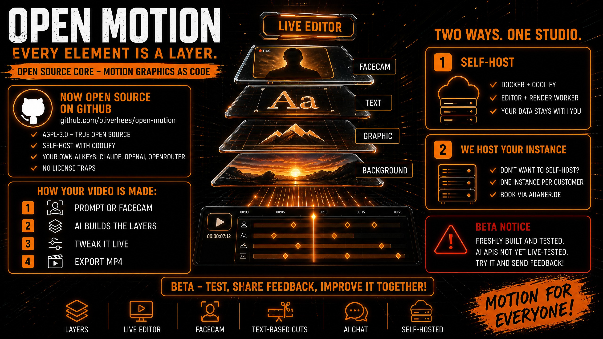
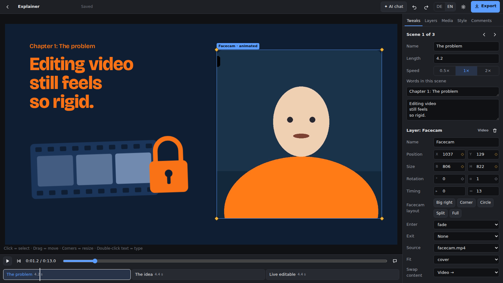
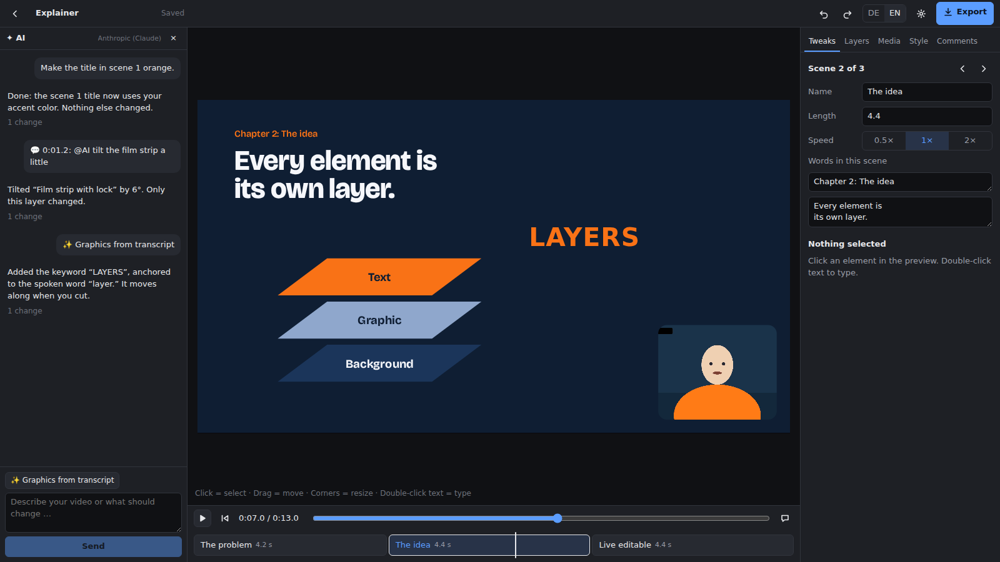
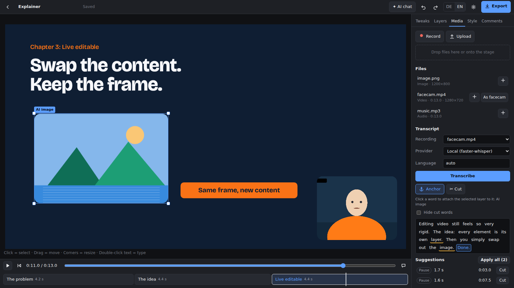
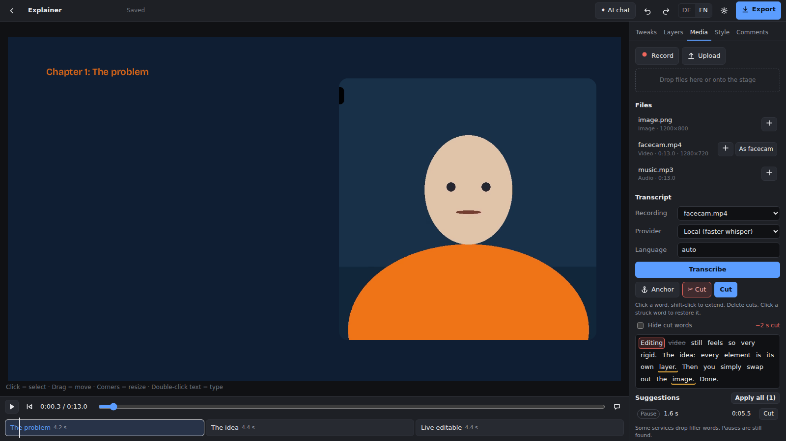

<p align="center">
  <a href="README.md">English</a> · <a href="README.de.md">Deutsch</a> · <a href="README.es.md">Español</a> · <a href="README.fr.md">Français</a> · <a href="README.pt-BR.md">Português</a> · <b>简体中文</b>
</p>

[](docs/assets/open-motion-hero.jpg)

# Open Motion

**开源、可自托管的动态图形工作室：每个元素都是一个可实时编辑的图层。**

[](LICENSE) [](#-状态) [](#-架构) [](docs/deploy-coolify.md) [](#-状态)

*描述你的视频、对着摄像头讲话，或直接拖入文件。AI 搭建图层，你实时微调，最后导出 MP4。*

[快速开始](#-快速开始) · [功能](#-功能) · [截图](#-截图) · [架构](#-架构) · [使用 Coolify 部署](docs/deploy-coolify.md) · [指南](docs/guide.md) · [许可证](#-许可证)

---

## 为什么选择 Open Motion

AI 视频生成器交给你的是成品像素。标题里错了一个词，或者某个图形偏左了一点，你只能整体重新生成，然后祈祷结果更好。传统剪辑软件给你完全的控制权，但每个动画都要花上好几个小时。

Open Motion 走第三条路：**用代码描述动态图形。** 每个元素都是独立的图层，包含边框、内容和时间。AI 编写这些图层，你在编辑器里直接操作：拖动、缩放、输入文字。渲染在最后一步进行，由无头 Chrome 和 FFmpeg 逐帧完成，与预览中看到的完全一致。

此外还有讲解视频需要的一切：浏览器内录制摄像头画面、带逐词时间戳的转录、锚定在口播词语上的图形，以及直接在文字中剪辑。删掉一个口误，摄像头画面、音频和图形都会自动跟着调整。

## 🏆 对比

|  | AI 视频生成器 | 传统剪辑软件 | Open Motion |
| --- | --- | --- | --- |
| **修改单个元素** | ❌ 通常要整体重新生成 | ✅ 手动 | ✅ 点击、输入或给 AI 留言；只改动这个元素 |
| **替换内容，保留边框** | ❌ | ⚠️ 繁琐 | ✅ 图形 → AI 图片 → 视频；位置和动画保持不变 |
| **摄像头 + 转录 + 文字剪辑** | ❌ | ⚠️ 常需额外软件 | ✅ 内置；图形挂在词语上，剪辑时自动移动 |
| **自选 AI 模型** | ❌ 只能用厂商的模型 | ❌ | ✅ 使用自己的密钥：Claude、OpenAI、OpenRouter；图片可用 Kie.ai、OpenAI、OpenRouter、Gemini |
| **自托管，数据留在自己手里** | ❌ 云端 | ✅ 本地 | ✅ Docker + Coolify，每个项目一个文件夹 |
| **源代码** | ❌ | ❌ 大多不开放 | ✅ AGPL-3.0 |

说句公道话：用代码描述动画并在浏览器中渲染并不是新点子。我们补上的是"只渲染"时缺少的部分：一个 AI **和** 人可以同时编辑的图层模型、无需重新加载的实时编辑器、带文字剪辑的摄像头工作流，以及能根据硬件自动调优的渲染。

## ✨ 功能

- **图层系统：** 文字、形状、手绘图形（SVG）、图片、视频、音频。每个图层都有边框、关键帧、缓动以及入场和出场过渡。
- **实时编辑器：** 在预览中直接点击、拖动、缩放、输入。在播放头位置修改时会自动设置关键帧。只更新改动过的图层，移动视频时不会重新加载。
- **场景条与调整面板：** 每个场景的名称、时长和速度，以及该场景的全部文字一览无余。
- **AI 对话：** "为我的咖啡馆做一个 20 秒的动画" → 场景、文字、图形、图片。每次回答都可以单独撤销。
- **元素评论：** 点击元素，写下"@AI 把它改成绿色"，完成。只有这个元素会改变。
- **摄像头：** 浏览器内录制或上传，音频独立成轨，提供大窗、角落、圆形、分屏等布局按钮，过渡平滑。
- **逐词时间戳转录：** 本地使用 faster-whisper，或通过 OpenAI、ElevenLabs、Groq、Deepgram。
- **锚点：** 图形挂在口播的词语上。
- **文字剪辑：** 删除词语即剪辑视频。自动建议口头禅和长停顿；导出时音频带有无爆音的微淡入淡出。
- **AI 图片：** Kie.ai、OpenAI、OpenRouter 或 Gemini，生成后立即保存到本地。
- **导出：** MP4 或 GIF，720p 或 1080p，15/30/60 fps，可选更清晰的文字。
- **自适应渲染：** 识别 CPU、内存和 GPU（包括容器限制），规划渲染进程，并从每次导出中学习真实耗时。
- **双语界面：** 英语和德语可切换。
- **自托管：** 提供 `slim` 与 `whisper` 两种 Docker 镜像，编辑器和渲染进程作为独立服务运行。

## 📸 截图

| 实时编辑器 | AI 对话 |
| --- | --- |
| [](docs/assets/editor.png) | [](docs/assets/ai-chat.png) |
| **转录与锚点** | **文字剪辑** |
| [](docs/assets/transcript-anchors.png) | [](docs/assets/text-cut.png) |

<sub>AI 对话截图展示的是预先编排的对话；其中列出的修改确实已应用到项目中。</sub>

**示例视频**，完全由一份 Motion-Spec 渲染而成：


## 🚀 快速开始

**使用 Docker（推荐）：**

```bash
git clone https://github.com/oliverhees/open-motion.git
cd open-motion
cp .env.example .env            # 设置 OPENMOTION_PASSWORD
docker compose -f docker-compose.yml -f docker-compose.local.yml --env-file .env up --build
# → http://localhost:4317
```

**不使用 Docker（Node 22.18+、FFmpeg）：**

```bash
npm install
npx hyperframes browser ensure  # 渲染用 Chrome（仅需一次）
npm run example:assets          # 示例文件（需要 Python + Pillow）
npm run editor:build
npm start                       # → http://localhost:4317
```

然后：⚙ 设置 → 填入 API 密钥 → 🩺 **立即测试**。

**部署到服务器：** [Coolify 分步指南](docs/deploy-coolify.md)

## 🧩 架构

**核心** 是 **Motion-Spec**：一个包含场景和图层的 JSON 文件。编辑器、AI 和渲染器都只读写这个文件。所有修改都必须通过 **补丁（patch）** 完成，例如 `set`、`setAt`（自动关键帧）、`swap`（替换内容、保留边框）或 `cut`（文字剪辑）。每个补丁都会经过校验，错误以通俗语言返回，让 AI 能够自我纠正。

**技术栈：** [HyperFrames](https://github.com/heygen-com/hyperframes)（Apache 2.0）把 HTML 渲染成视频。动画使用浏览器原生的 **Web Animations API**，刻意不使用 GSAP，因为其许可证禁止用于可视化动画编辑器。TypeScript 直接在 Node 22 中运行；编辑器基于 React + Vite。编辑器与渲染进程通过基于文件的队列通信。

更多：[指南](docs/guide.md) · [Motion-Spec 参考](docs/motion-spec.md)

## 🛡️ 安全

密码登录，会话 Cookie 为 `HttpOnly`/`SameSite=Lax`（HTTPS 下另加 `Secure`），连续 10 次失败后锁定；API 令牌只以哈希形式保存；服务商密钥从不发送到浏览器；CSRF 防护；AI 生成的 SVG 会被清理；容器以非 root 身份运行。发现漏洞？请参阅 [SECURITY.md](SECURITY.md)。

## 🔧 状态

**Beta 0.1，由 47 个自动化测试和端到端测试保障。** 已完成：图层核心、实时编辑器、摄像头录制、本地转录、文字剪辑、AI 代理（测试模式和模拟服务商）、登录与令牌、编辑器与渲染进程分离、自适应渲染。待完成：使用真实密钥实测所有 API、在 Coolify 上验证 Docker 构建、MCP 连接器以及 Skill。

**已知限制：** AI、图片和转录 API 按照各服务商的文档与响应格式实现，使用真实密钥的实测正在进行中。整个场景暂时不会跟随文字剪辑移动。目前所有人共用一个密码。部分服务端消息仍为德语。

详情：[STATUS.md](STATUS.md)

## 🗺️ 路线图

1. **MCP 连接器**：支持 Claude（网页版、Code、Cowork）、Hermes 及其他代理。
2. **Skill**：设计规则、Spec 速查表和示例。
3. **场景锚定到词语。**
4. **专业时间线**：轨道、关键帧曲线、音轨。

## 📜 许可证

核心代码采用 **[GNU Affero General Public License v3.0 (AGPL-3.0)](LICENSE)**，这是经 OSI 认可的开源许可证。Copyleft：如果你修改了 Open Motion 并以网络服务形式提供，必须同时公开修改后的源代码。**不使用 GSAP。**

## 🏠 不想自己托管？

你可以在自己的基础设施上运行 Open Motion（[Coolify 指南](docs/deploy-coolify.md)）。如果你不想自己搭建，**我们可以为你运行一个专属实例。** 联系方式：[aiianer.de](https://aiianer.de) 或 [Issues](https://github.com/oliverhees/open-motion/issues)。

## 🤝 参与贡献

欢迎提交 Issue、Pull Request 和参与讨论。请参阅 [CONTRIBUTING.md](CONTRIBUTING.md) 和 [行为准则](CODE_OF_CONDUCT.md)。

---

<p align="center">由 <b>Oliver Hees – Der Aiianer</b> 用 ❤️ 与热情打造 · <a href="https://aiianer.de">aiianer.de</a> · <a href="LICENSE">AGPL-3.0</a></p>
